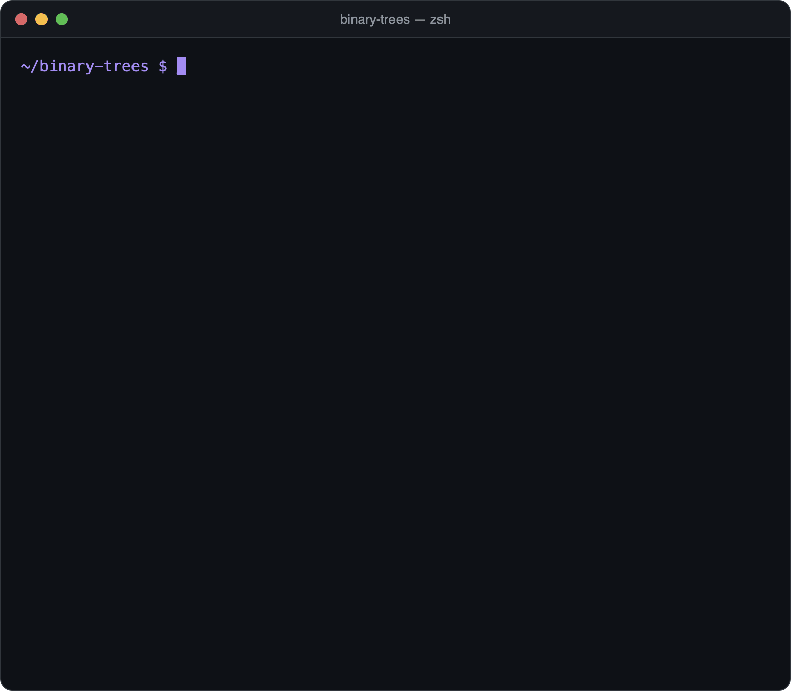

<div align="center">

# Binary Trees

Classic binary tree algorithms in Java, written recursively.


[](https://github.com/meuselina/binary-trees/actions/workflows/build.yml)




</div>

## What's inside

| Method | What it does |
|---|---|
| `preorder` | Traversal: root, left, right |
| `inorder` | Traversal: left, root, right |
| `postorder` | Traversal: left, right, root |
| `isFull` | Checks if every node has either 0 or 2 children (full binary tree) |
| `isPerfect` | Checks if the tree is perfect (all leaves on the same level) |
| `height` | Height of the tree |
| `search` | Searches for a value in a binary search tree |
| `insert` | Inserts a value into a binary search tree |
| `delete` | Deletes a value from a binary search tree (leaf, one child, or two children via the inorder successor) |
| `min` | Smallest value in a binary search tree |

## Quick start

You only need a JDK (tested with Java 21). No build tool, no external libraries.

```bash
git clone https://github.com/meuselina/binary-trees.git
cd binary-trees

javac *.java
java Main                       # demo
java BinaryTreeAlgorithmsTest   # 27 tests
```

## Example output

```
Inserted: 50 30 70 20 40 60 80

        50
      /    \
    30      70
   /  \    /  \
  20  40  60  80

Preorder:  50 30 20 40 70 60 80
Inorder:   20 30 40 50 60 70 80   (sorted!)
Postorder: 20 40 30 60 80 70 50

Height:         2
Full:           true
Perfect:        true
Search 60:      true
Search 65:      false

After inserting 65:
Height:         3
Full:           false
Perfect:        false

After deleting 50 (the root):
Root:           60
Inorder:   20 30 40 60 65 70 80
```

```
$ java BinaryTreeAlgorithmsTest
27 tests passed, 0 failed.
```

## Files

| File | Purpose |
|---|---|
| `BinaryTreeAlgorithms.java` | The algorithms |
| `BinaryTree.java` | The binary tree data structure |
| `Main.java` | Demo that builds a search tree and runs every algorithm |
| `BinaryTreeAlgorithmsTest.java` | 27 automated tests, including edge cases (empty tree, single node, duplicates, deleting the root or the last value) |

## Built with

Java, standard library only.

## License

[MIT](LICENSE) © 2026 Selina Meusel
